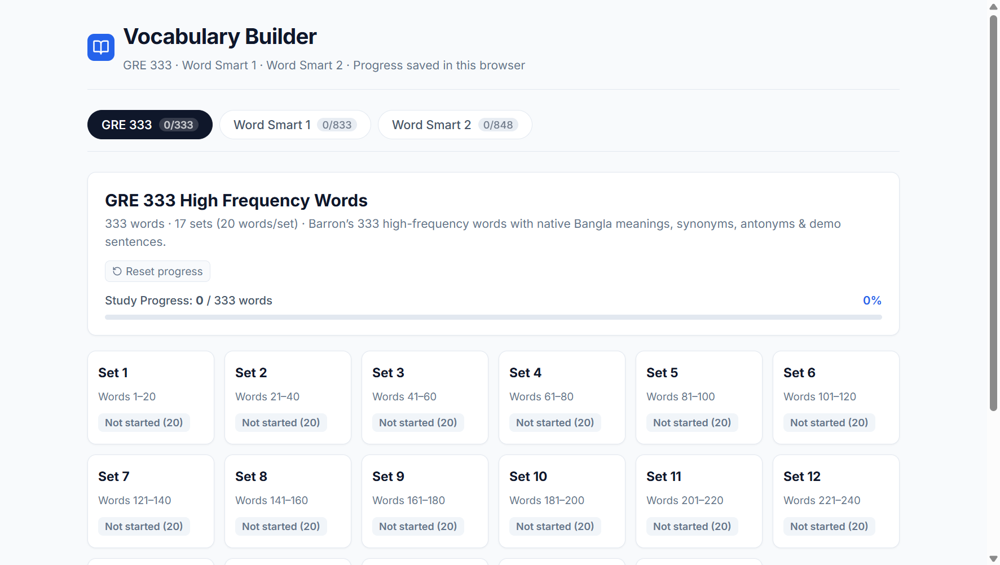
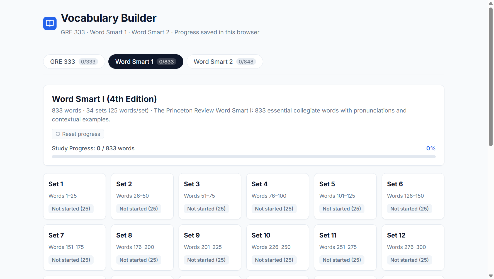
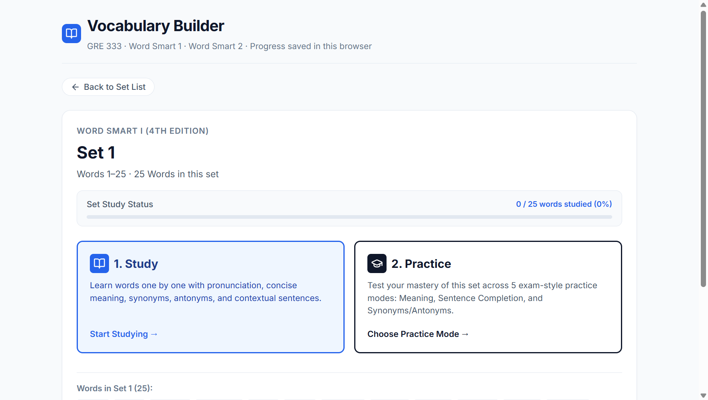
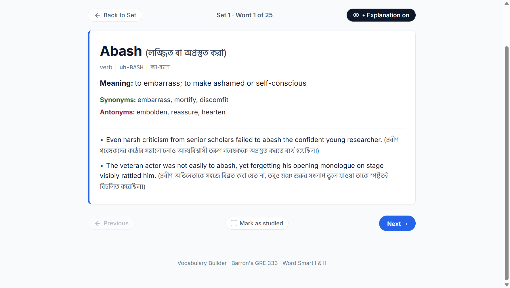
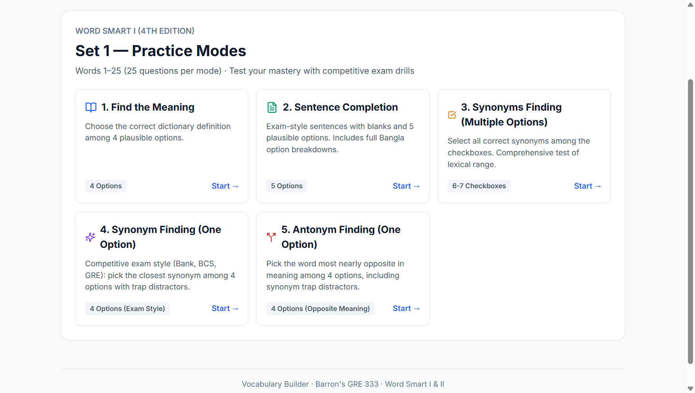
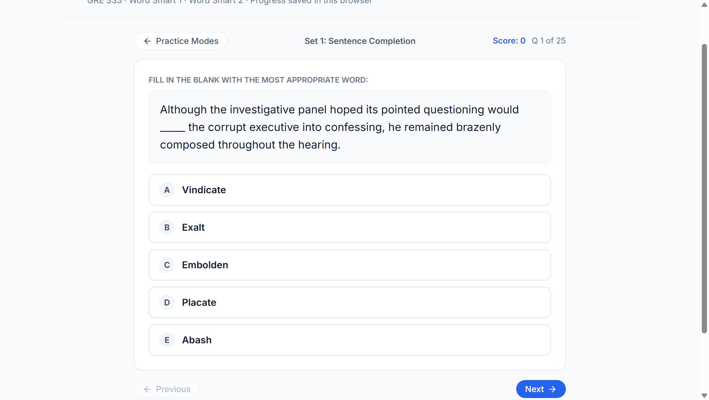
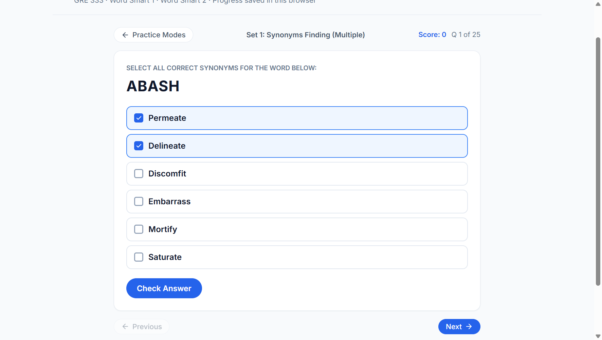
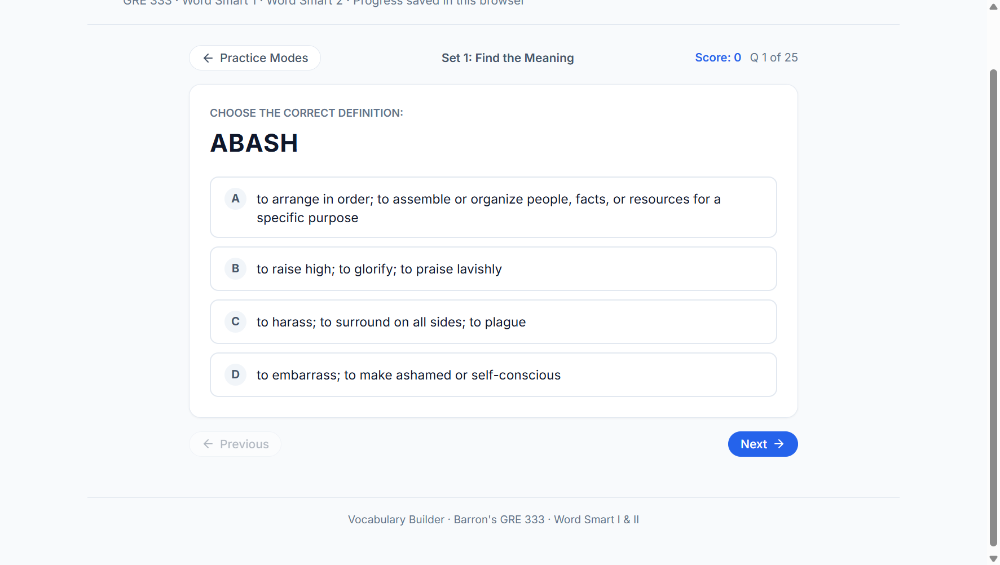
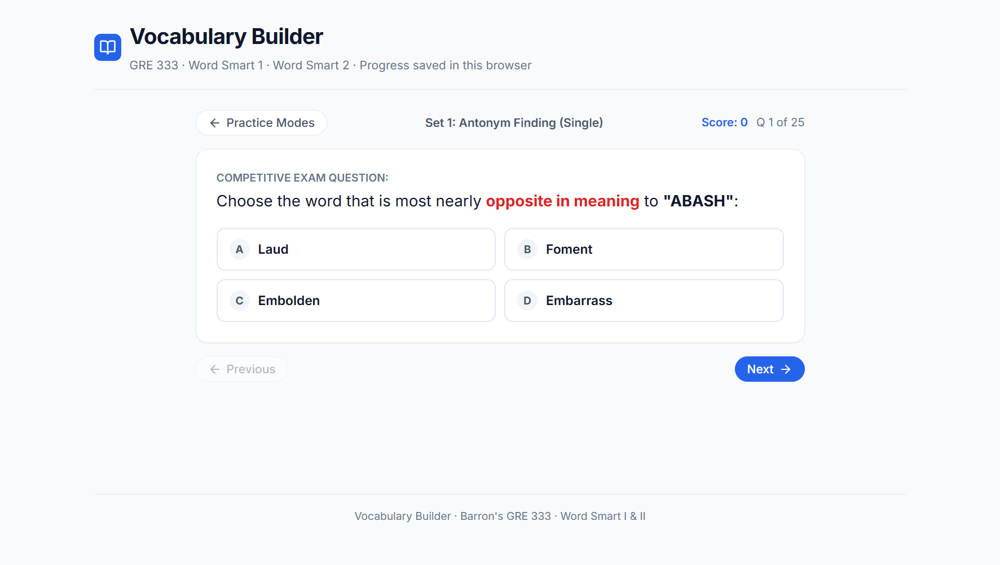

# Vocabulary Builder

> **A modern, bilingual vocabulary mastery application engineered for GRE, BCS, Bank, and competitive exam aspirants.**  
> Featuring Barron’s GRE 333 High-Frequency Words and Princeton Review’s Word Smart I & II with authentic Bengali translations, phonetic pronunciation guides, contextual example sentences, and 5 interactive active-recall practice modes.

---

## Overview

**Vocabulary Builder** bridges the gap between rote memorization and true collegiate English mastery. Designed specifically for learners who think and learn in Bengali and English, it pairs rigorous exam-standard vocabulary with nuanced bilingual explanations, native pronunciations, and contextual sentence completion drills adapted from official GRE and 501 Sentence Completion questions.

---

## Key Features & Visual Walkthrough

### 1. Multi-Corpus Dashboard & Live Study Tracking
Switch effortlessly between three premier vocabulary corpora with instant progress metrics and persisted session state.



- **Corpus Switching:** Toggle seamlessly between **Barron's GRE 333**, **Word Smart 1**, and **Word Smart 2**. Active corpus selection is automatically saved in `localStorage`.
- **Real-Time Progress Metrics:** Live progress bars track both per-source totals (`X / Total words studied`) and completion percentages.
- **Set Status Badges:** Visual indicator chips identify sets that are `Not started`, `In progress (X/25)`, or `Completed`.
- **Progress Reset:** Individual per-corpus progress reset with confirmation safeguard.

---

### 2. Comprehensive Modular Set Grids
All vocabulary corpora are split into bite-sized, 20- to 25-word sets designed to optimize cognitive retention and support daily spaced repetition.



- **Word Smart I (4th Edition):** 833 essential collegiate words organized systematically across 34 structured sets.
- **Barron’s GRE 333:** 333 high-frequency words grouped into 17 manageable sets.
- **Word Smart II:** 848 advanced collegiate words across 34 sets for BCS and competitive exam mastery.

---

### 3. Dedicated Set Hub & Dual-Path Learning Center
Every set features an analytics hub allowing learners to choose between guided study and rigorous self-testing.



- **Set Analytics:** Displays start-to-end word index ranges, total word count, and set-specific study completion.
- **Dual-Path Navigation:** Jump directly into interactive **Flashcard Study Mode** or dive into the **5 Practice Drills**.

---

### 4. Bilingual Flashcard Study Mode
An in-depth study deck delivering full phonetic, semantic, and contextual mastery for every single word.



- **Dual Phonetic Guides:** English phonetic pronunciation guide (e.g. `uh-BASH`) alongside natural Bengali phonetic script (`আ-ব্যাশ`).
- **Authentic Bengali Definitions:** Nuanced, culturally natural Bengali meanings without machine-translation glitches or Bijoy artifacts.
- **Collegiate English Definitions:** Exact, concise definitions aligned with Princeton Review and Barron’s standards.
- **Contextual Example Sentences:** Two distinct, high-caliber example sentences with full Bengali translations.
- **Curated Synonyms & Antonyms:** Minimum 3–4 vetted synonyms and antonyms sharing exact part-of-speech parity.
- **Keyboard Navigation:** Navigate words using `←` and `→` arrow keys, and toggle explanations using `Space` or `E`.
- **Automatic Progress Persistence:** Viewing words and navigating through sets dynamically updates your studied count.

---

### 5. Practice Hub: 5 Targeted Drill Modes
A comprehensive practice suite designed to test vocabulary from multiple cognitive angles.



- **Five Focused Testing Modes:**
  1. *Find the Meaning* (4 Options)
  2. *Sentence Completion* (5 Options, Exam Standard)
  3. *Synonyms Finding* (Multi-Option Checkbox Matrix)
  4. *Synonym Finding* (Single Option, Exam Style)
  5. *Antonym Finding* (Single Option)
- **Live Scoreboard:** Real-time correct/incorrect tally and immediate feedback on completion.

---

### 6. Exam-Standard Sentence Completion Mode
Realistic, competitive exam-style questions adapted from Princeton Review and 501 Sentence Completion materials.



- **Context-Rich Sentence Stems:** Authentic fill-in-the-blank questions (`_____`) that test subtle context clues.
- **Uniform Distractors:** All 5 options (A–E) share the exact grammatical part of speech to eliminate process-of-elimination shortcuts.
- **Full Bengali Sentence Translation:** Immediate translation of the completed sentence revealed upon answering.
- **Bengali Breakdown for All Options:** See the exact Bengali meaning for every option (A through E).
- **In-Depth Grammatical Explanation:** Clear rationale explaining why the correct word fits the contextual tone and logic.

---

### 7. Multi-Synonym Matrix Challenge
Go beyond single-word recognition by testing your complete lexical range with multi-select checkboxes.



- **Multi-Select Checkboxes:** Identify all valid synonyms from a curated 5-to-6 word pool.
- **Balanced True/False Ratios:** Uniformly distributed true synonyms mixed with plausible semantic distractors.
- **Comprehensive Feedback:** Detailed breakdown of both correctly identified synonyms and missed alternatives.

---

### 8. Rapid Meaning Recognition Drill
Sharpen fast recall under exam conditions with 4-option dictionary definition matching.



- **Clean 4-Option Interface:** Match target words to their concise English and Bengali definitions.
- **Balanced Distractors:** Non-target choices sampled dynamically from the same corpus using deterministic Fisher-Yates shuffling.

---

### 9. Antonym Discrimination Drill
Master antonyms and opposing semantic spectrums with challenging single-select drills.



- **Targeted Antonym Testing:** Identify the exact polar opposite word among 4 closely matched candidates.
- **Grammatical Parity:** Enforces strict part-of-speech consistency between questions and answer choices.

---

## Dataset Architecture & Corpus Metrics

| Corpus | Total Words | Total Sets | Words / Set | Coverage & Focus |
| :--- | :---: | :---: | :---: | :--- |
| **Barron’s GRE 333** | 333 | 17 | 20 (Last: 13) | GRE General Verbal high-frequency vocabulary |
| **Word Smart I (4th Ed.)** | 833 | 34 | 25 (Last: 8) | Essential collegiate vocabulary for GRE, SAT & BCS |
| **Word Smart II** | 848 | 34 | 25 (Last: 23) | Advanced collegiate & professional vocabulary |
| **Total Ecosystem** | **2,014** | **85** | — | **100% Gold-Standard Audited & Schema Compliant** |

### Rigorous Quality Assurance Rules
Every word object in `src/data/` conforms to the strict [`VocabWord`](src/data/vocabSchema.ts) TypeScript interface:
1. **Zero Scrape Contamination:** Bijoy/OCR encoding artifacts, duplicate vowel signs, and placeholder strings (`(বাংলা অর্থ)`, `syn-`, `বিকল্প অর্থ`) have been audited and removed.
2. **Deterministic PRNG Shuffling:** Options and distractors are randomized using FNV-1a hash seeding and Mulberry32 PRNG to eliminate positional clustering.
3. **Distractor Initial-Letter Diversity:** Multiple options avoid starting with the same letter (e.g. avoiding 4 options all starting with `A`).
4. **Part-of-Speech Parity:** Target words, options, distractors, and example sentences maintain strict POS alignment.

---

## Tech Stack

- **Frontend Framework:** [React 18](https://react.dev/) + [TypeScript](https://www.typescriptlang.org/)
- **Build Tool & Dev Server:** [Vite 6](https://vitejs.dev/) with Hot Module Replacement (HMR)
- **Icons:** [Lucide React](https://lucide.dev/)
- **Typography:** Google Fonts (`Inter` for Latin script & `Hind Siliguri` for Bengali script)
- **State & Storage:** Local browser storage (`localStorage`) for privacy-preserving offline progress tracking

---

## Getting Started

### Prerequisites
- [Node.js](https://nodejs.org/) (version 18 or higher recommended)
- `npm` or `yarn`

### Installation

1. **Clone the repository:**
   ```bash
   git clone https://github.com/asif-852/vocabulary-builder.git
   cd vocabulary-builder
   ```

2. **Install dependencies:**
   ```bash
   npm install
   ```

3. **Start the development server:**
   ```bash
   npm run dev
   ```
   Open [http://localhost:5173](http://localhost:5173) in your browser.

4. **Build for production:**
   ```bash
   npm run build
   ```
   The production-ready assets will be generated in the `dist/` directory.

---

## License

This project is licensed under the [MIT License](LICENSE).
